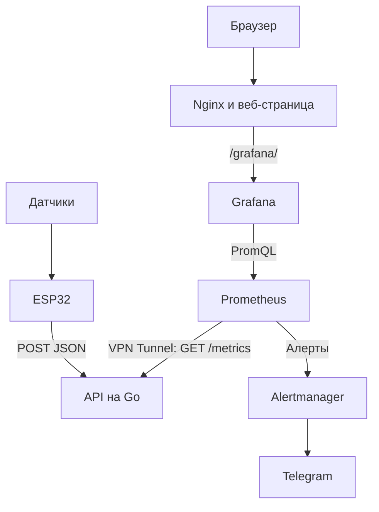

# Smart Greenhouse

Система мониторинга теплицы на ESP32 с API на Go, хранением метрик в Prometheus, визуализацией в Grafana и уведомлениями в Telegram через Alertmanager. Серверные компоненты запускаются с помощью Docker Compose.

ESP32 считывает показания датчиков и передает их по Wi-Fi в формате JSON. API предоставляет метрики для Prometheus, а веб-страница объединяет изображения теплицы, пример уведомления и встроенный дашборд Grafana.

При наличие только серого IP, используется Wireguard tunnel для передачи метрик из API к VPS по зашифрованному туннелю. На VPS реализовывается сервисная инфраструктура: prometheus, grafana, alertmager, docker, nginx.
## Возможности

- Считывание температуры с DS18B20 и DHT11.
- Считывание влажности воздуха, влажности почвы и относительной освещенности на ESP32.
- Отправка показаний каждые 10 секунд отдельными запросами для каждого датчика.
- Экспорт температуры, влажности, освещенности и количества принятых сообщений в Prometheus.
- Оповещение о высокой температуре через Telegram.
- Веб-страница на HTML/CSS с Grafana, Nginx и HTTPS.

API обрабатывает температуру, влажность воздуха и почвы, а также относительную освещенность. Показания разных датчиков различаются по меткам `device_id` и `sensor_id`. **Управление поливом, вентиляцией и освещением в коде не реализовано.**

## Архитектура



API хранит последние значения в памяти. Историю измерений сохраняет Prometheus в Docker volume. После перезапуска API значения датчиков появятся снова после получения новой телеметрии.

## Компоненты проекта

| Путь                             | Назначение                                                        |
| -------------------------------- | ----------------------------------------------------------------- |
| `esp-32/readsensors.cpp`         | Основная прошивка ESP32                                           |
| `esp-32/preferences.example.cpp` | Пример записи Wi-Fi и API-ключа в NVS                             |
| `greenhouse-api/main.go`         | HTTP API и метрики Prometheus                                     |
| `greenhouse-api/Dockerfile`      | multistage сборка API                                             |
| `monitoring/prometheus/`         | Сбор метрик и правила оповещений                                  |
| `monitoring/alertmanager/`       | Маршрутизация алертов и шаблон Telegram                           |
| `monitoring/grafana/`            | Каталог для конфигурации Grafana, пока содержит только `.gitkeep` |
| `web-server/nginx.conf`          | HTTPS, статические файлы и проксирование Grafana                  |
| `web-server/html/`               | Веб-страница, стили и изображения                                 |
| `certbot/`                       | Каталоги сертификатов и ACME challenge                            |
| `docker-compose.yml`             | Серверные сервисы, сети и volumes                                 |
| `.env.example`                   | Пример переменных окружения                                       |

## Оборудование

- ESP32 с Wi-Fi.
- Датчик температуры DS18B20.
- Датчик температуры и влажности DHT11.
- Аналоговый датчик влажности почвы.
- Аналоговый датчик освещенности.
- Raspberry Pi 5 для работы API.
- VPS с Docker Engine и Docker Compose v2.

GPIO, заданные в прошивке:

| Датчик | GPIO ESP32 | Идентификатор в телеметрии |
| --- | --- | --- |
| DS18B20 | 4 | `ds18b20-01` |
| DHT11 | 5 | `dht11-01` |
| Влажность почвы | 34 | `soil-moisture-01` |
| Освещенность | 35 | `light=sensor-01` |

Общий идентификатор контроллера: `greenhouse-esp32-01`. Для нескольких ESP32 задайте каждому устройству свой `DEVICE_ID`. Запись `light=sensor-01` соответствует текущему коду.

Таблица описывает сигнальные выводы. Питание и допустимые уровни сигналов выбирайте по характеристикам конкретных модулей. Аналоговые входы ESP32 должны получать сигнал в допустимом для платы диапазоне.

## Запуск сервера

Все команды выполняются из корня репозитория. Инструкция ниже сначала запускает мониторинг в локальной сети. Веб-страница с HTTPS подключается отдельно после получения сертификата.

### 1. Подготовить конфигурацию

```bash
git clone https://github.com/ExIntegra/smart-greenhouse.git
cd smart-greenhouse
cp .env.example .env
```

**Если используется разделение на VPS и клиента с серым IP, то со стороны клиента нужно развернуть код на ESP32 и greenhouse-api. Docker compose разворачивается на VPS.**

В `.env` задайте собственный непустой ключ:

```dotenv
API_KEY=replace-with-your-own-random-key
```

Этот же ключ необходимо записать в ESP32. Файл `.env` исключен из Git.

В текущем Compose используется только `API_KEY`. Переменные `DOMAIN`, `TELEGRAM_API_URL` и `TELEGRAM_BOT_TOKEN` из `.env.example` не подставляются в настройки Nginx, Grafana или Alertmanager. Их нужно настроить в соответствующих файлах.

### 2. Настроить доступ к API

В `monitoring/prometheus/prometheus.yml` замените адрес `10.0.0.3:8000` у задания `greenhouse-api` на имя Compose-сервиса:

```yaml
  - job_name: "greenhouse-api"
    static_configs:
      - targets: ["greenhouse-api:8000"]
```

API слушает порт `8000` внутри контейнера, но исходный Compose не публикует его на хосте. Чтобы ESP32 могла обращаться к API, создайте рядом с `docker-compose.yml` файл `docker-compose.override.yml`:

```yaml
services:
  greenhouse-api:
    ports:
      - "8000:8000"
```

Docker Compose автоматически подключает этот файл. Разрешите доступ к порту `8000` из сети ESP32. В таком варианте телеметрия передается по HTTP, поэтому используйте доверенную локальную сеть или защищенный сетевой канал.

### 3. Настроить Telegram

Создайте бота через [BotFather](https://t.me/BotFather), добавьте его в нужный чат и сохраните токен в локальном файле:

```bash
mkdir -p secrets
printf '%s' 'YOUR_TELEGRAM_BOT_TOKEN' > secrets/telegram_token
```

Каталог `secrets/` исключен из Git. Файл должен быть доступен для чтения пользователю внутри контейнера Alertmanager.

В `monitoring/alertmanager/alertmanager.yml` укажите собственные значения:

- `chat_id`: идентификатор чата, куда отправлять уведомления.
- `message_thread_id`: идентификатор темы в группе с темами. Удалите этот параметр, если темы не используются.

Alertmanager читает токен из `/run/secrets/telegram_token`. Значение `TELEGRAM_BOT_TOKEN` в `.env` этот файл не заменяет.

### 4. Подготовить Grafana для локального запуска

В `docker-compose.yml` временно замените `GF_SERVER_ROOT_URL` на адрес своего сервера:

```yaml
GF_SERVER_ROOT_URL: "http://192.168.0.133:3000/grafana/"
```

Здесь и далее `192.168.0.133` приведен как пример. Подставьте реальный IP сервера. Остальные параметры Grafana, включая обслуживание из `/grafana/`, оставьте как в Compose.

### 5. Запустить сервисы

```bash
docker compose up -d --build greenhouse-api prometheus grafana alertmanager node_exporter cadvisor
docker compose ps
```

Nginx пока не запускается: его HTTPS-конфигурация требует существующих файлов сертификата. Certbot вызывается отдельно для выдачи и продления сертификатов.

| Сервис | Адрес после настройки |
| --- | --- |
| API | `http://SERVER_IP:8000` |
| Grafana | `http://SERVER_IP:3000/grafana/` |
| Prometheus | `http://127.0.0.1:9090` на сервере |
| Alertmanager | `http://127.0.0.1:9093` на сервере |
| cAdvisor | `http://127.0.0.1:8090` на сервере |
| Node Exporter | Порт `9100` хоста |

Для Grafana в исходной конфигурации включен анонимный просмотр с ролью `Viewer`. Административную настройку выполняйте после входа в учетную запись администратора.

## Проверка API

Проверить доступность процесса:

```bash
curl http://localhost:8000/health
```

Ожидаемый ответ:

```json
{"status":"ok"}
```

Отправить тестовую температуру, заменив значение заголовка своим API-ключом:

```bash
curl -X POST http://localhost:8000/api/v1/telemetry \
  -H 'Content-Type: application/json' \
  -H 'X-API-Key: replace-with-your-own-random-key' \
  -d '{"device_id":"greenhouse-esp32-01","sensor_id":"ds18b20-01","temperature_c":23.5}'
```

При успешном приеме API возвращает `{"status":"ok"}`. Проверить метрики:

```bash
curl -s http://localhost:8000/metrics | grep '^greenhouse_'
```

Примеры JSON, отправляемых остальными датчиками. Каждый объект передается отдельным POST-запросом с тем же API-ключом.

Температура и влажность воздуха с DHT11:

```json
{
  "device_id": "greenhouse-esp32-01",
  "sensor_id": "dht11-01",
  "temperature_c": 24.0,
  "humidity_percent": 58.0
}
```

Влажность почвы:

```json
{
  "device_id": "greenhouse-esp32-01",
  "sensor_id": "soil-moisture-01",
  "humidity_percent": 42.0
}
```

Относительная освещенность:

```json
{
  "device_id": "greenhouse-esp32-01",
  "sensor_id": "light=sensor-01",
  "light_percent": 76.0
}
```

### HTTP endpoints

| Метод | Путь | Назначение |
| --- | --- | --- |
| `POST` | `/api/v1/telemetry` | Прием JSON, требуется заголовок `X-API-Key` |
| `GET` | `/health` | Проверка доступности процесса |
| `GET` | `/metrics` | Экспорт метрик для Prometheus |

Для телеметрии обязательны непустые `device_id` и `sensor_id`.

| Поле измерения | Допустимый диапазон |
| --- | --- |
| `temperature_c` | От `-55` до `125` °C |
| `humidity_percent` | От `0` до `100`% |
| `light_percent` | От `0` до `100`% |

Поля измерений в Go представлены указателями `*float64`. Если поле отсутствует или содержит `null`, соответствующая метрика не обновляется. Числовое значение `0` обрабатывается как настоящее показание.

Неправильный метод для `/api/v1/telemetry` возвращает `405`, неверный ключ `401`, некорректный JSON или значение вне допустимого диапазона `400`.

### Метрики проекта

| Метрика | Тип | Метки | Значение |
| --- | --- | --- | --- |
| `greenhouse_temperature_celsius` | Gauge | `device_id`, `sensor_id` | Последняя принятая температура в °C |
| `greenhouse_humidity_percent` | Gauge | `device_id`, `sensor_id` | Последняя принятая влажность воздуха или почвы в % |
| `greenhouse_light_percent` | Gauge | `device_id`, `sensor_id` | Последняя принятая относительная освещенность в % |
| `greenhouse_telemetry_received_total` | Counter | `device_id` | Количество принятых сообщений устройства |

Влажность воздуха и почвы хранится в общей метрике `greenhouse_humidity_percent`. Для их разделения используйте `sensor_id`: `dht11-01` для воздуха и `soil-moisture-01` для почвы.

## Прошивка ESP32

Используется Arduino framework для ESP32. Для сборки нужны библиотеки `OneWire`, `DallasTemperature`, `DHT sensor library` с зависимостями и `ArduinoJson` версии 7. `WiFi`, `HTTPClient` и `Preferences` входят в Arduino core для ESP32.

1. Создайте отдельный Arduino-скетч на основе `esp-32/preferences.example.cpp`.
2. Укажите `WIFI_SSID`, `WIFI_PASSWORD` и `API_KEY`, совпадающий с серверным ключом.
3. Загрузите скетч на ESP32. Он запишет настройки в NVS в пространстве `config`.
4. Создайте другой скетч на основе `esp-32/readsensors.cpp`. Для Arduino IDE перенесите содержимое в основной файл `.ino`.
5. В `SERVER_URL` задайте адрес API, например `http://192.168.0.133:8000/api/v1/telemetry`.
6. Проверьте GPIO, идентификаторы датчиков и значения калибровки.
7. Загрузите основную прошивку без полного стирания flash, чтобы сохранить NVS.
8. Откройте Serial Monitor со скоростью `115200` и проверьте показания и HTTP-ответы.

Оба исходника содержат `setup()` и `loop()`, поэтому их нужно загружать по очереди как отдельные скетчи. При отсутствии настроек основная прошивка выводит `NVS config error` и останавливает работу.

### Калибровка аналоговых датчиков

Для влажности почвы в коде заданы `SOIL_DRY = 3400` и `SOIL_WET = 1140`:

```text
влажность (%) = (SOIL_DRY - raw) * 100 / (SOIL_DRY - SOIL_WET)
```

Для освещенности заданы `LIGHT_DARK = 4095` и `LIGHT_BRIGHT = 0`:

```text
освещенность (%) = (LIGHT_DARK - raw) * 100 / (LIGHT_DARK - LIGHT_BRIGHT)
```

Результаты ограничиваются диапазоном от 0 до 100%. Подставьте значения, полученные на своих датчиках. Освещенность здесь относительная, в люксах она не измеряется.

## Дашборд Grafana

После запуска добавьте в Grafana источник данных Prometheus с адресом `http://prometheus:9090`.

Пример запроса для графика температуры:

```promql
greenhouse_temperature_celsius{device_id="greenhouse-esp32-01",sensor_id="ds18b20-01"}
```

Влажность воздуха:

```promql
greenhouse_humidity_percent{device_id="greenhouse-esp32-01",sensor_id="dht11-01"}
```

Влажность почвы:

```promql
greenhouse_humidity_percent{device_id="greenhouse-esp32-01",sensor_id="soil-moisture-01"}
```

Относительная освещенность:

```promql
greenhouse_light_percent{device_id="greenhouse-esp32-01",sensor_id="light=sensor-01"}
```

Пример запроса для скорости поступления сообщений:

```promql
rate(greenhouse_telemetry_received_total[5m])
```

В репозитории нет экспорта дашборда и provisioning-конфигурации Grafana. Создайте дашборд вручную, затем замените путь `/grafana/d/adv6z8s/metriki?kiosk` в `web-server/html/index.html` на путь своего дашборда.

## Оповещения

Правило `HighTemperature` находится в `monitoring/prometheus/rules.yml` и срабатывает, когда температура датчика `ds18b20-01` на устройстве `greenhouse-esp32-01` выше `25` °C в течение одной минуты.

Алерт получает метку `severity: warning` и передается в Telegram. Alertmanager группирует уведомления по `instance`, повторяет активное уведомление с настроенным интервалом `1m` и отправляет сообщение о разрешении алерта. Текст сообщения задается в `monitoring/alertmanager/templates/telegram.tmpl`.

Чтобы изменить порог, длительность или отслеживаемый датчик, отредактируйте правило и перезапустите Prometheus:

```bash
docker compose restart prometheus
```

## Веб-страница и HTTPS

Для публичного доступа нужен домен, направленный на сервер, и доступность TCP-портов `80` и `443`. В примерах ниже замените `example.ru` своим доменом.

1. В `web-server/nginx.conf` замените `growpanel.ru` и `www.growpanel.ru` на свои имена. Обновите пути к сертификатам на `/etc/letsencrypt/live/example.ru/fullchain.pem` и `/etc/letsencrypt/live/example.ru/privkey.pem`.
2. В `docker-compose.yml` задайте `GF_SERVER_ROOT_URL: "https://example.ru/grafana/"`.
3. При необходимости измените домен в подвале `web-server/html/index.html` и укажите путь своего дашборда.
4. Пока Nginx остановлен и порт `80` свободен, получите сертификат:

```bash
docker compose run --rm -p 80:80 certbot certonly \
  --standalone \
  --cert-name example.ru \
  -d example.ru \
  -d www.example.ru \
  --email admin@example.ru \
  --agree-tos \
  --no-eff-email
```

Оба доменных имени должны указывать на сервер. Если `www` не используется, удалите его из команды и конфигурации Nginx.

Запустите Nginx и примените измененный адрес Grafana:

```bash
docker compose up -d grafana nginx
```

Страница будет доступна по адресу `https://example.ru`, Grafana по адресу `https://example.ru/grafana/`. HTTP-запросы перенаправляются на HTTPS. Изображение с подписью видеонаблюдения на странице является статическим файлом, видеопоток в проекте не подключен.

Для продления сертификата, впервые выданного через `--standalone`, используйте webroot, который уже обслуживает Nginx:

```bash
docker compose run --rm certbot renew \
  --cert-name example.ru \
  --webroot -w /var/www/certbot
docker compose exec nginx nginx -s reload
```

Автоматическое продление в Compose не настроено. Команды продления и перезагрузки Nginx нужно запускать по расписанию на сервере.

## Обслуживание

Посмотреть состояние и логи:

```bash
docker compose ps
docker compose logs -f greenhouse-api prometheus alertmanager
```

Применить изменения конфигурации Alertmanager:

```bash
docker compose restart alertmanager
```

Пересобрать API после изменения Go-кода:

```bash
docker compose up -d --build greenhouse-api
```

Остановить проект с сохранением данных:

```bash
docker compose down
```

Данные Prometheus, Grafana и Alertmanager находятся в именованных Docker volumes. Сертификаты сохраняются в `certbot/conf/`. Добавление `-v` к команде `down` удаляет именованные volumes и хранящиеся в них данные.

## Ограничения текущей реализации

- Отсутствие новых показаний не отслеживается отдельным правилом. Последняя температура остается в API до перезапуска, поэтому действующий алерт может сохраняться после отключения датчика.
- В Nginx настроено проксирование только Grafana. Маршрут `/api/v1/telemetry` через публичный HTTPS-домен не опубликован.
- `/health` проверяет доступность API-процесса, но не состояние датчиков и остальных компонентов.
- Настройки домена, адреса сервера и Telegram содержат значения конкретного развертывания и требуют замены перед запуском.
